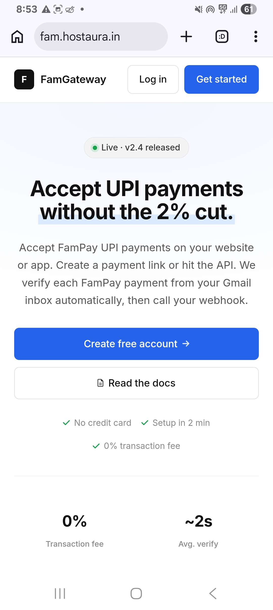
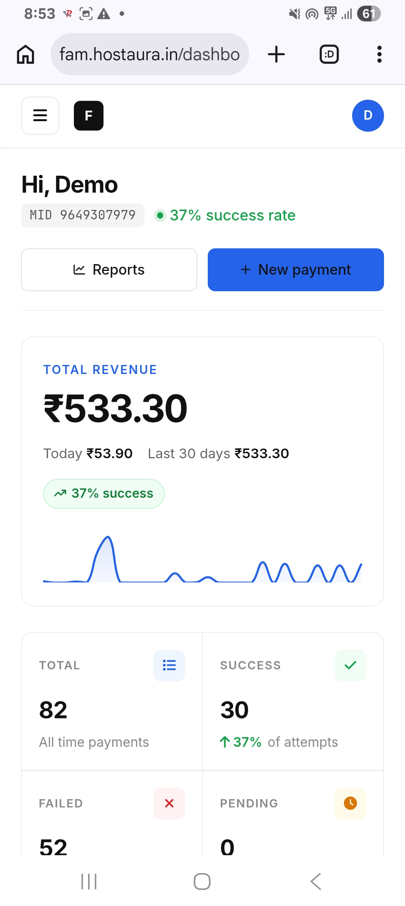
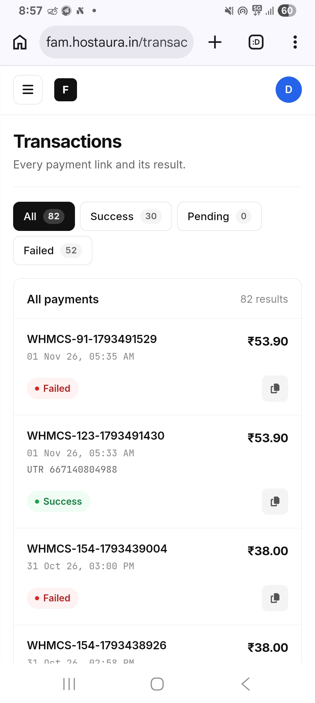
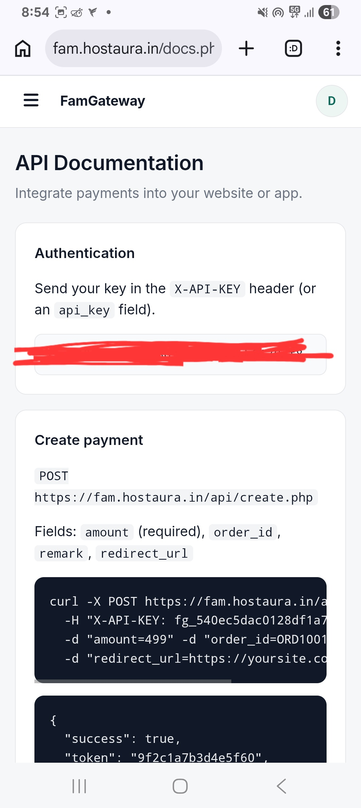
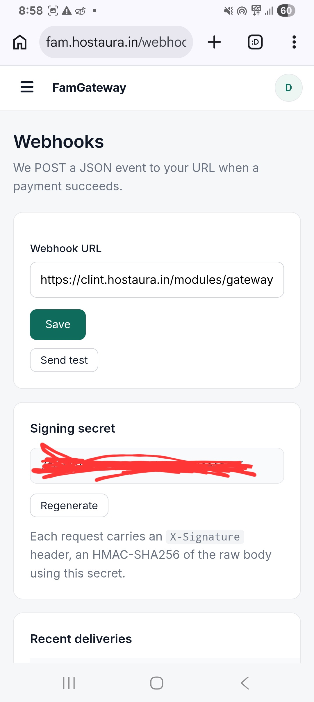
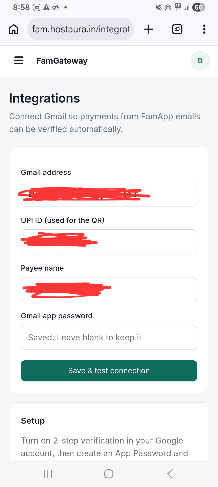

FAM Gateway

  <strong>A Smarter Way to Integrate Payments.</strong>

  A proprietary payment integration platform built for developers and digital businesses.

  <a href="https://fam.hostaura.in">Live Platform</a> ·
  <a href="https://fam.hostaura.in/docs.php">API Documentation</a>

  
  
  
  

---

Overview

FAM Gateway is an independent payment integration platform designed to simplify UPI payment collection, transaction tracking and automated payment verification.

It provides developers with a straightforward API, payment links, webhooks and a dedicated merchant dashboard.

Platform Preview

  
   <em>Official Landing Page</em>

Dashboard

  
   <em>Merchant Dashboard & Analytics</em>

Core Features

Feature| Description
Payment Links| Generate payment links
UPI Payments| Accept FamPay UPI payments
Automatic Verification| Verify payment confirmations through Gmail
REST API| Integrate payments into applications
Webhooks| Receive payment event notifications
Transactions| Track payment history and status
Analytics| Monitor revenue and payment performance
API Keys| Manage developer authentication

Transactions

  

Developer API

FAM Gateway provides REST API endpoints for payment creation and status verification.

Create Payment

"POST /api/create.php"

Check Payment Status

"GET /api/status.php"

Authentication is supported through the "X-API-KEY" header.

Full documentation: https://fam.hostaura.in/docs.php

  

Webhook Integration

FAM Gateway supports payment event notifications through configurable webhook URLs.

- HMAC-SHA256 signature verification
- Payment success notifications
- Delivery history
- Test webhook functionality

  

Integrations

Connect Gmail and configure your UPI details for automated payment verification.

  

Technology Stack

- PHP
- MySQL
- JavaScript
- HTML5
- CSS3
- REST API
- HMAC-SHA256

Project Information

Detail| Information
Project| FAM Gateway
Developer| Mohit Kumar
Platform| Web Application
Website| https://fam.hostaura.in
Version| 2.4
Status| Live & Active
Ownership| Proprietary

Official Links

- Website: https://fam.hostaura.in
- API Documentation: https://fam.hostaura.in/docs.php
- GitHub: https://github.com/mohitdev-india/fam-gateway

---

  <strong>Built with purpose. Designed for simplicity.</strong>
   
  © Mohit Kumar · FAM Gateway
   
  All rights reserved.

